# ParkSense

This is a [Next.js](https://nextjs.org) project bootstrapped with [`create-next-app`](https://nextjs.org/docs/app/api-reference/cli/create-next-app).

## Screen gallery

Select a screenshot to view it at full size.

| 01 · Welcome | 02 · Log in | 03 · Home |
| :---: | :---: | :---: |
| [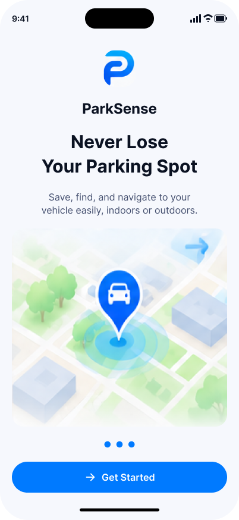](design_refs/01-welcome.png) | [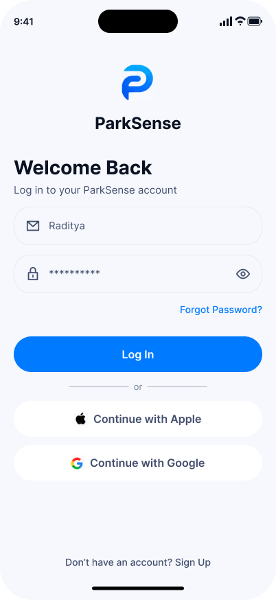](design_refs/02-login.png) | [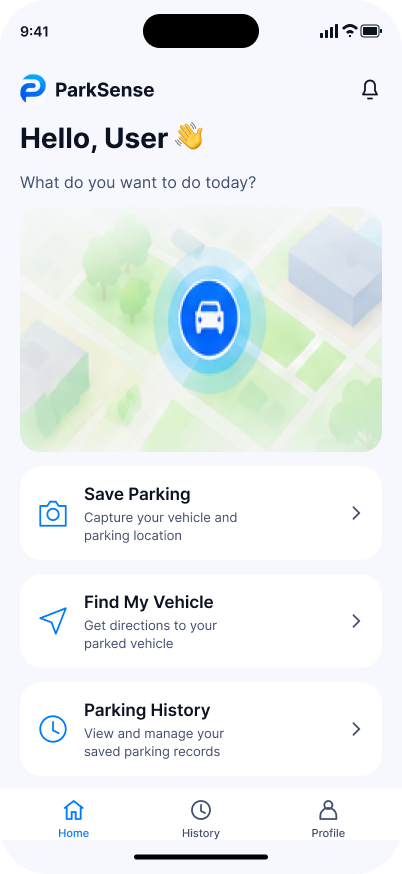](design_refs/03-home.png) |

| 04 · Save parking | 05 · Find my vehicle | 06 · History |
| :---: | :---: | :---: |
| [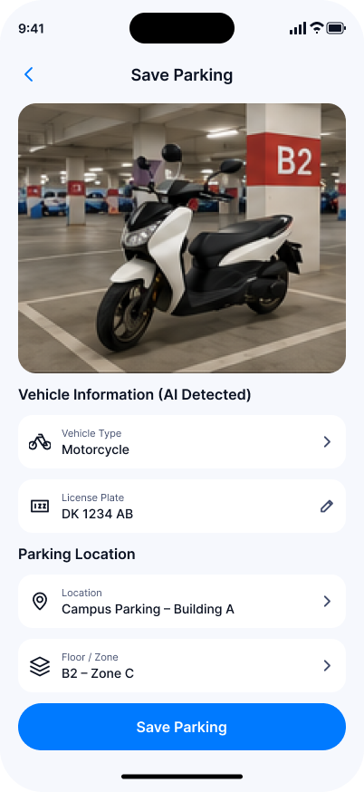](design_refs/04-save-parking.png) | [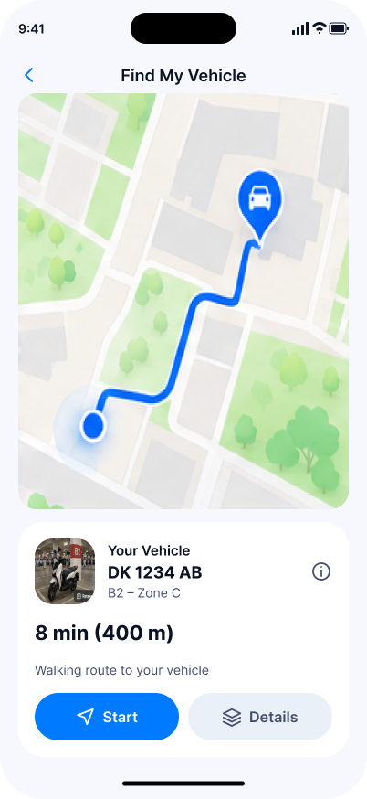](design_refs/05-find-my-vehicle.png) | [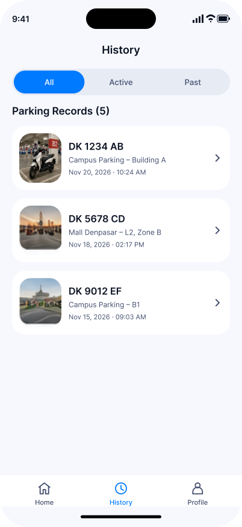](design_refs/06-history.png) |

| 07 · Profile | 08 · Edit parking details | 09 · Take vehicle photo |
| :---: | :---: | :---: |
| [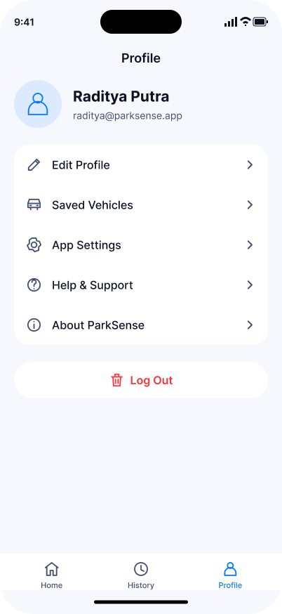](design_refs/07-profile.png) | [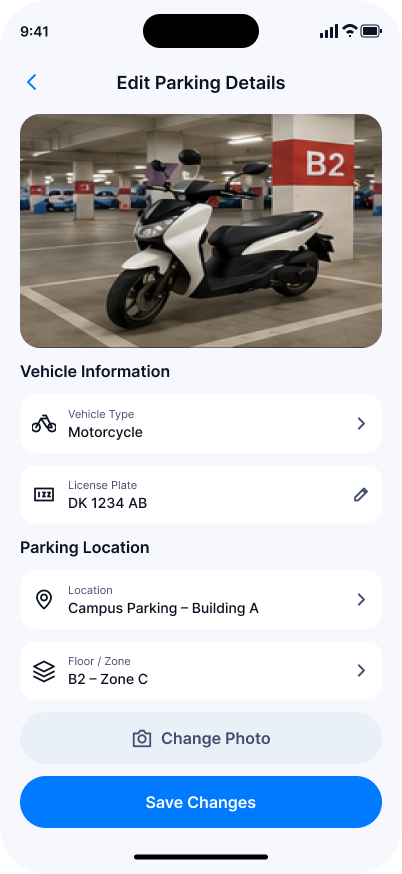](design_refs/08-edit-parking-details.png) | [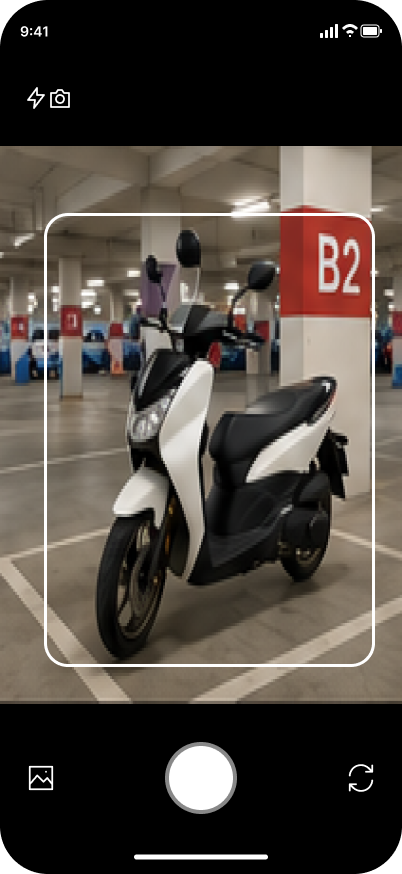](design_refs/09-take-vehicle-photo.png) |

| 10 · Delete record | 11 · Navigate | 12 · Arrived at location |
| :---: | :---: | :---: |
| [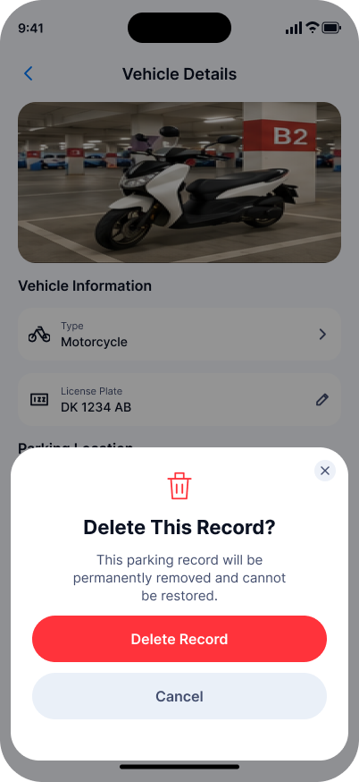](design_refs/10-delete-record.png) | [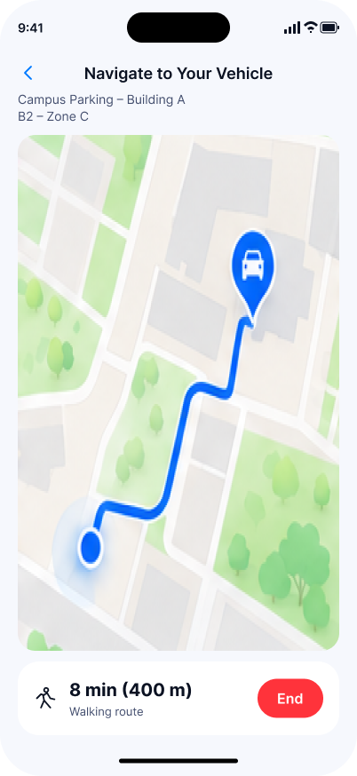](design_refs/11-navigate.png) | [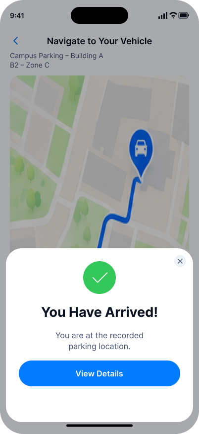](design_refs/12-arrived-at-location.png) |

| 13 · Vehicle details | 14 · Photo preview | 15 · Edit all parking information |
| :---: | :---: | :---: |
| [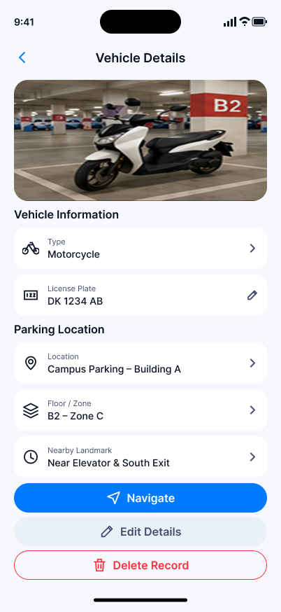](design_refs/13-vehicle-details.png) | [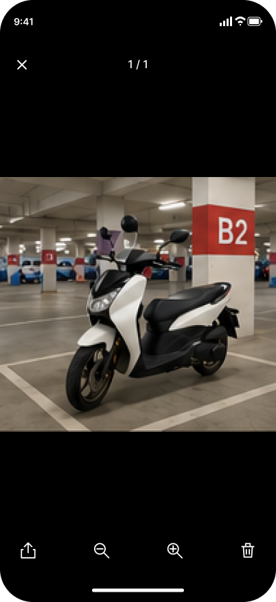](design_refs/14-photo-preview.png) | [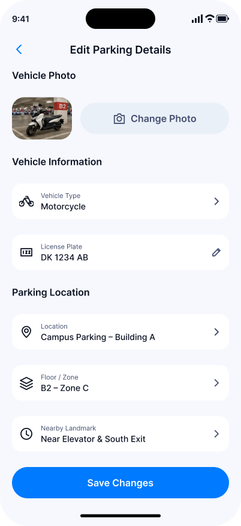](design_refs/15-edit-all-parking-information.png) |

## Supabase

Set up the database, email sign-in, private photos and local history import using the [ParkSense setup guide](supabase/SETUP.md).

## Vehicle photo recognition

On **Save Parking**, taking or uploading a vehicle photo starts a scan automatically. The form fills in the recognized vehicle type and Indonesian plate number (for example, `DK 1234 AB`). Check the details before saving. You can edit either field while the scan runs.

YOLOv10n detects cars, motorcycles and bicycles. PaddleOCR reads the most prominent detected vehicle, or the whole photo for a plate close-up. A clear, front-facing or rear-facing photo with one vehicle works best.

Scanning runs on the device in a Web Worker. The browser loads the models from ParkSense on the first scan. The model files are included in `public/models`, and `npm run dev` and `npm run build` prepare the WebAssembly runtime. Model sources are [YOLOv10n ONNX (AGPL-3.0)](https://huggingface.co/onnx-community/yolov10n) and [PaddleOCR PP-OCRv6 tiny (Apache-2.0)](https://github.com/PaddlePaddle/PaddleOCR/tree/main/paddleocr-js).

## Getting Started

First, run the development server:

```bash
npm run dev
# or
yarn dev
# or
pnpm dev
# or
bun dev
```

Open [http://localhost:3000](http://localhost:3000) with your browser to see the result.

You can start editing the page by modifying `app/page.tsx`. The page auto-updates as you edit the file.

This project uses [`next/font`](https://nextjs.org/docs/app/building-your-application/optimizing/fonts) to automatically optimize and load [Geist](https://vercel.com/font), a new font family for Vercel.

## Learn More

To learn more about Next.js, take a look at the following resources:

- [Next.js Documentation](https://nextjs.org/docs) - learn about Next.js features and API.
- [Learn Next.js](https://nextjs.org/learn) - an interactive Next.js tutorial.

You can check out [the Next.js GitHub repository](https://github.com/vercel/next.js) - your feedback and contributions are welcome!

## Deploy on Vercel

The easiest way to deploy your Next.js app is to use the [Vercel Platform](https://vercel.com/new?utm_medium=default-template&filter=next.js&utm_source=create-next-app&utm_campaign=create-next-app-readme) from the creators of Next.js.

Check out our [Next.js deployment documentation](https://nextjs.org/docs/app/building-your-application/deploying) for more details.
